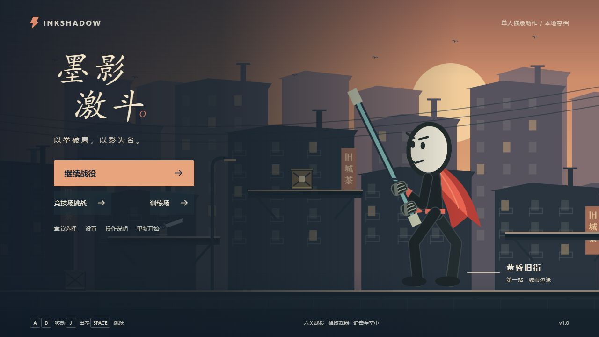
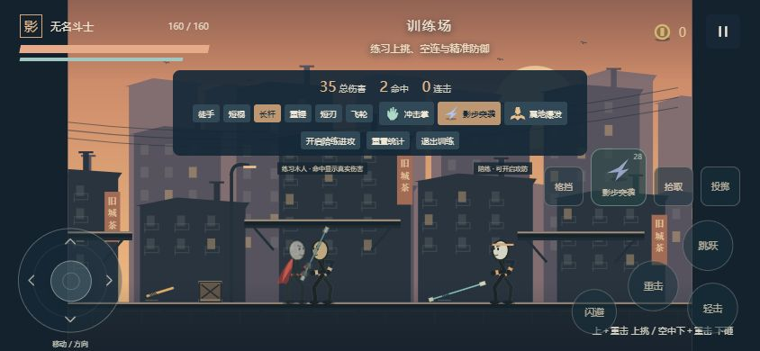

# 墨影激斗 · INKSHADOW

原创非像素风、纯横版平台火柴人格斗游戏。都市动作片场景，浅色大头与圆润黑色肢体，玩家佩戴红色披风（无头带）。使用 TypeScript、Canvas 2D 和 Web Audio 实现，无运行时网络资源、账号或后端依赖。



项目仓库：[Mesting42/inkshadow-clash](https://github.com/Mesting42/inkshadow-clash)。

下载当前交付版本：[静态网页包](releases/墨影激斗-web-v1.0.0.zip) · [完整源码与验收证据包](releases/墨影激斗-source-v1.0.0.zip)。



## 启动与构建

需要 Node.js 22.12+。首次安装后可离线运行；首次安装依赖需要 npm 网络访问。

```powershell
cd D:\AnLi\墨影激斗
npm install
npm run dev
```

本地开发地址：**http://localhost:5297/**。端口使用 strictPort，若被占用会报错，不会停止其他项目。修改端口时使用 `npx vite --host 0.0.0.0 --port <空闲端口> --strictPort`。

```powershell
npm run build
npm run preview
```

构建产物位于 `dist/`；生产预览地址 http://localhost:4178/。部署 Cloudflare Pages 等静态托管时，构建命令填写 `npm run build`，输出目录填写 `dist`。不需要服务器函数或环境密钥。请通过 HTTP(S) 访问，不要双击构建后的 HTML 文件。

## 已实现内容

- 六个完整关卡、三个主题区域：黄昏旧街、雨夜工厂、高塔决斗场。
- 每关三处封锁战斗，普通战斗分三批增援；章节关末为独立 Boss 战。高台、缺口、单向平台、奖励支路、破坏箱、传送台、预警机关和塔区风场。
- 四段轻击、重击、上挑、有限空连、下砸、闪避、正面格挡及 0.16 秒精准防御。
- 徒手完整可玩；短棍、长杆、重锤、双刃和飞轮五类武器，包含耐久、拾取交换及投掷。长杆、重锤双手握点绑定杆轴；双刃左右手分别持刃。
- 七类普通敌人、精英变体和三位多招式、多阶段 Boss；最终首领有三阶段和有限召唤。
- 十四种有层数上限的被动强化、战后三选一、金币商店、三种可替换主动技能与保命护身符。
- 三种主动技能拥有对应图标、专属颜色、冷却反馈、音效和技能特效。掌印冲击、疾影刃光、震波裂纹分别对应冲击掌、影步突袭、震地爆发。
- 独立竞技场、波间强化、最高波次与得分纪录；训练场支持武器/技能切换、伤害和命中统计、可启停陪练。
- 主菜单、章节解锁、装备构筑预览、暂停、按键调整、设置、继续游戏和胜负结算。
- 手机/平板左侧模拟摇杆、右侧攻击按钮，多点输入、斜向招式辅助、安全区域、竖屏暂停与等比画面。
- 独立音乐/音效音量，镜头震动、闪光、特效强度、触控大小与透明度设置。
- 独立命名空间版本存档，关卡安全检查点、坏档回退、失焦自动暂停、固定 60Hz 逻辑和有界对象回收。

## 键盘操作

| 操作 | 默认按键 |
| --- | --- |
| 移动 | A / D 或左右方向键 |
| 跳跃 | Space |
| 轻击 / 空中攻击 | J，连续按下形成四段连招 |
| 重击 | K |
| 上挑 | W / ↑ ＋ K |
| 下砸 | 空中 S / ↓ ＋ K |
| 闪避 | L，消耗 20 能量，有短暂无敌与冷却 |
| 格挡 / 精准防御 | 按住 I；攻击到来前 0.16 秒内按下可精准防御，必须面向来源 |
| 拾取 / 交换 / 交互 | E |
| 投掷当前武器 | Q |
| 主动技能 | U，震地爆发需立足地面 |
| 从单向平台下落 | S / ↓ ＋ Space，实体地基不可下穿 |
| 暂停 | Esc |

红色三角代表不可格挡攻击，使用闪避或跳跃；金色预警可以防御。攻击有收招，输入缓冲仅 0.15 秒，不能无限取消。默认一次跳跃，获得「燕返」后可以额外空中跳跃一次。

## 手机和平板

横屏进入游戏，左侧拖动摇杆控制方向，轻推慢走、推满全速；向上推配合重击为上挑，空中向下推配合重击为下砸，向下推配合跳跃可穿过单向平台。松手回中，可一只手移动、另一只手同时操作攻击/跳跃。右侧主动技能键显示实际装备技能图标、名字、消耗及冷却。

触控默认根据浏览器指针能力显示。如设备识别异常或要在桌面检查触控，在设置中将「触控按钮显示」切为「始终显示」。竖屏自动暂停，恢复横屏后主动选择继续战斗。

同一局域网的移动设备可以访问开发服务器终端打印的 Network 地址；浏览器保存数据按访问来源分别存储。实际设备防火墙与网络策略需允许该端口。

## 存档

键名：`inkshadow.clash.save.v1`。战役在每关安全入口保存，包含该关入口时的构筑、装备、金币和耐久。继续或失败重试重建该关，不能恢复半场正在生效的攻击。当前关的未保存战斗进度不会保留。设置、章节完成状态与竞技场纪录独立保留。

## 测试

```powershell
npm test
npm run simulate
npm run simulate -- --arena
node --expose-gc --import tsx scripts/simulate.ts --arena --endurance
```

`npm test` 验证判定、取消、格挡、硬直保护、平台、投掷扫掠、奖励上限、存档、暂停、重试、多点触控、摇杆、握点和技能特效生命周期。

战役模拟通过正常输入与界面选择，复用真实主循环、AI、伤害和关卡流程，不改位置、耐久或调用胜利函数。竞技场 endurance 是 **45 分钟等价逻辑步进**，包含正常失败后重开，不代表实体设备连续渲染 45 分钟。

详细验收与范围见 [测试报告](docs/TEST_REPORT.md)，系统关系与扩展方式见 [交接文档](docs/HANDOVER.md)。

## 已知限制

- 当前使用程序化骨骼动画、Canvas 场景及本地合成音乐/音效，不含配音和真人录制音乐。
- 战役时长按普通玩家 15–25 分钟设计；读取全部预备帧且不消耗菜单时间的自动机器人可更快通关，该目标仍需更多真人样本校准。
- 浏览器尺寸与指针操作验证不能等同于实体 iOS/Android 真机多指及浏览器工具栏验证；具体证据见测试报告。
- 检查点粒度为关卡入口；不保存当前战斗的一半。不同浏览器/访问来源不共享存档。
- 不包含在线多人、云同步、服务器排行榜和手柄输入。
- 不使用全布娃娃物理；击飞和倒地由受约束的惯性与姿态表现。

## 资源与来源

角色、场景、图标、特效、音频均由本项目代码生成。造型比例与表情参考用户在聊天中提供的图片，改为红色披风且无头带。未从参考网址复制代码或下载素材。第三方开发依赖与版本由 `package-lock.json` 固定。
